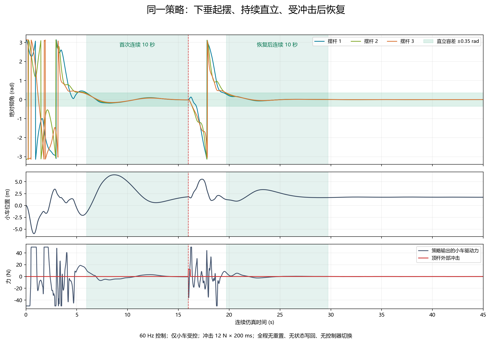

# 连续起摆与扰动恢复评测

Isaac Sim 5.1.0 / Isaac Lab 2.3.2，正式评测日期：2026-09-28。使用同一个 PPO 策略，唯一动作是小车驱动力 ±50 N；三根摆杆无主动控制力矩。

## 验收规则

1. 每次试验只在开始时设置初态并重置一次，全程不切换控制器、不写回运行状态、不中途重置。
2. 三杆绝对倾角均在向上 ±0.35 rad 内，连续保持 10 秒。
3. 随后对顶杆施加世界 X 方向 ±12 N、200 ms 冲击，再连续保持 10 秒。正、负方向按环境编号交替。
4. 小车全程满足 |x| < 11.8 m；一旦越界永久判失败，碰限位后返回不算恢复成功。
5. 两组下垂试验分别运行 60 秒，大角度随机组运行 70 秒。角度按周期判断，完整转动后回到直立可以计分。

起摆资产使用 ±12 m 行程、地面 z = −10 m，各杆长 3 m。这些结果不适用于原 ±3 m 短轨道。

## 正式结果

| 初态 | 样本 / seed | 首次保持 10 秒 | 完整流程成功 |
| --- | --- | ---: | ---: |
| 精确静止下垂 | 128 / 2 | 128/128 | 128/128 |
| 下垂附近随机 | 128 / 0 | 128/128 | 128/128 |
| 大角度随机 | 256 / 1 | 228/256 | 226/256（88.3%） |

精确下垂组是同一静止初态的并行重复，不是 128 个随机姿态。下垂附近各杆绝对角为 π ±0.08 rad；大角度组为各杆独立均匀采样 [−π, π]，其余小幅位置、速度随机化见评测代码。

随机组仍有 30 次未完成完整流程，主要限制是起摆时轨道越界。结果不保证任意初态、任意扰动或不同运行环境下均成功。

原始逐次记录：[精确下垂](recovery_exact_seed2.json) · [下垂附近](recovery_down_seed0.json) · [随机大角度](recovery_random_seed1.json)。

## 权重来源

[交付策略](../checkpoints/swingup_policy.pt) 来自 seed 2、2048 个并行环境、从头 PPO 训练的第 3300 次迭代；网络为 256/256/128，11 维观测、1 维动作，无教师、蒸馏或控制器切换。

SHA256：`b54de7ba0139a9f8dfe35bc43c1b0868303bec1157c88a6f1c28f377abfdda9b`。配置与来源见 [checkpoints](../checkpoints/provenance.json)。训练扰动沿顶杆局部 X，正式验收冲击沿世界 X。

## 复现

在项目根目录运行：

```powershell
# 默认 128 / 128 / 256 个环境，覆盖报告会写入 reports
.\evaluate.ps1

# 小规模检查，另存结果以保留正式报告
.\evaluate.ps1 -NumEnvs 1 -OutputDir reports/smoke

# 重新记录一次 45 秒连续轨迹与视频
.\run.ps1 scripts/eval_swingup.py --headless --initial down_exact --seed 2 --num_envs 1 --episode_s 45 --push_force 0 --recovery_force 12 --recovery_ms 200 --video --output reports/demo_recovery.json --trace reports/demo_trace.csv
.\run.ps1 scripts/plot_evaluation.py
```

[45 秒未剪辑实录](videos/swingup_down_exact_seed2-step-0.mp4) · [该次结果](demo_recovery.json) · [逐步轨迹](demo_trace.csv)。

这次记录在 15.97 s 完成首次保持后受到冲击，冲击后最大倾角约 3.13 rad，随后重新摆起，29.73 s 完成恢复后的 10 秒保持。角度折回 [−π, π] 的曲线跳变属于表示方式，物理状态连续。



## 验证范围

物理检查覆盖 4 自由度、固定底座、重力运动、有效观测、小车驱动力、摆杆零控制力矩和起摆限位。演示每 25 秒施加冲击，正式验收在首次保持完成后施加，两者触发规则不同。

迁移目录后的 12 项物理检查、4 环境从零短训 2 次迭代和交付策略 45 秒连续起摆恢复复测均已通过；权重哈希不变。以上 128/128/256 的正式统计保留原评测日期，本次迁移复测没有重新替代全部正式样本。
